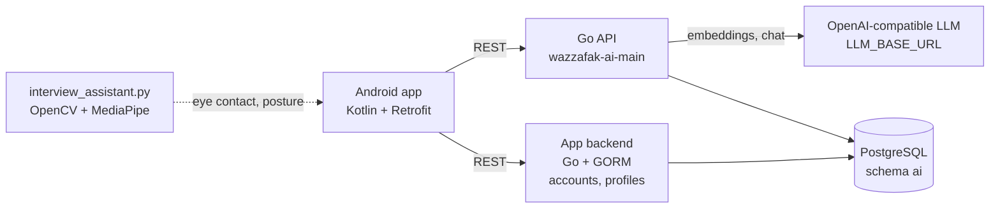

# Wazzafak AI: interview practice system

My final-year project at Rafik Hariri University (2025). An Android app where a candidate uploads a CV and practises a job interview with an AI interviewer, then gets scored feedback on the content of their answers and on eye contact and posture.

## How it works



1. **CV ingestion.** `/v1/cv/ingest` splits the CV into chunks, embeds each one (`EMBEDDING_MODEL`, default `text-embedding-3-small`) and stores the vectors in `ai.cv_chunks`.
2. **Questions.** `/v1/next-question` retrieves the CV and knowledge-base chunks most similar to the interview context (cosine similarity, computed in Go over embeddings stored as JSONB) and asks the chat model (`CHAT_MODEL`) for the next question.
3. **Evaluation.** `/v1/evaluate` scores each answer with `EVAL_MODEL`; `/v1/session/*`, `/v1/feedback` and `/v1/user/scores` track a session and return CV, technical and behavioural feedback.
4. **Behaviour analysis.** `interview_assistant.py` uses MediaPipe face and pose landmarks to estimate eye direction (eye aspect ratio) and posture during the interview.

This is retrieval-augmented generation inside a fixed pipeline, not an autonomous agent.

## Repository layout

| Path | Contents |
|---|---|
| `wazzafak-ai-main/` | Go interview API (`main.go`, `cv_parser.go`), `init.sql`, Dockerfile, Render/Railway configs |
| `Androidfyp-main/android/` | Kotlin Android app |
| `Androidfyp-main/backend/` | Go backend for accounts and profiles (GORM) |
| `interview_assistant.py` | Webcam behaviour analysis (OpenCV, MediaPipe) |
| `docs/SETUP_GUIDE.md` | Full setup, Android networking and troubleshooting guide |

## Running it

Requirements: Go 1.24, Docker, PostgreSQL (or a Supabase project), Android Studio, Python 3.10+ for the behaviour analysis.

```bash
cd wazzafak-ai-main
cp env.example .env           # set DATABASE_URL; LLM_API_KEY only if USE_MOCK=0
psql "$DATABASE_URL" -f init.sql
USE_MOCK=1 go run .           # mock mode: no OpenAI calls, canned responses
curl http://localhost:8089/v1/health
```

With `USE_MOCK=1` no LLM calls are made: embeddings come from a deterministic text-hash function and answers get heuristic placeholder scores, so the flow can be explored without an API key. Mock responses are not model output. Set `USE_MOCK=0` and `LLM_API_KEY` (plus `LLM_BASE_URL` for a non-OpenAI provider) for real generation.

The Android app's backend needs `DATABASE_URL` too (see `Androidfyp-main/backend/.env.example`). Release signing reads `RELEASE_KEYSTORE_PATH`, `RELEASE_KEYSTORE_PASSWORD` and `RELEASE_KEY_PASSWORD` from the environment. Emulator networking and APK builds are covered in `docs/SETUP_GUIDE.md`.

## Engineering notes

- **Provider-agnostic LLM client.** `LLM_BASE_URL` lets the same code target OpenAI or any compatible API.
- **Supabase pooler and prepared statements.** The transaction-mode pooler breaks cached prepared statements, so the GORM connection uses the simple protocol and disables statement caching.
- **Embeddings in JSONB.** `init.sql` enables pgvector, but similarity is computed in Go. That is fine at project scale; at larger scale I would store `vector` columns with an index and query with `<=>`.

## Known limitations

- `main.go` is a single large file; handlers, LLM client and repositories should be separate packages.
- Some handlers return internal error text to the client.
- No automated tests.

## Security

Credentials come only from environment variables. An earlier version committed a database password and the Android release keystore; both were removed from the code and replaced with environment configuration.
